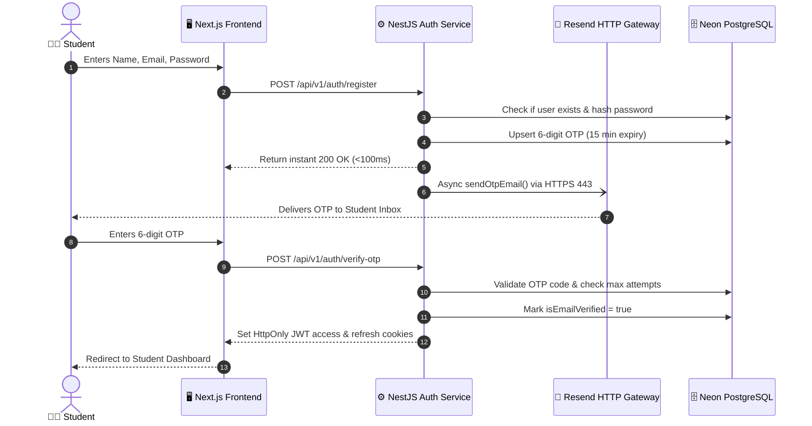
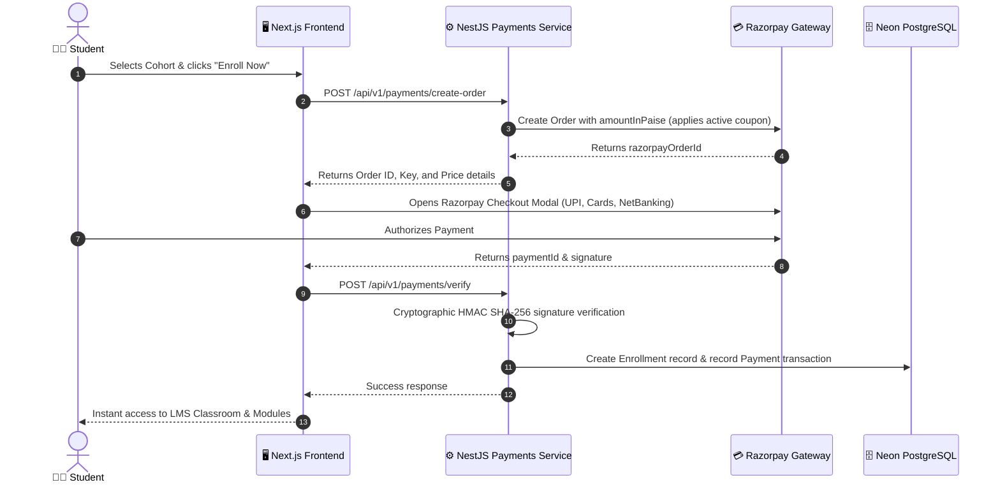
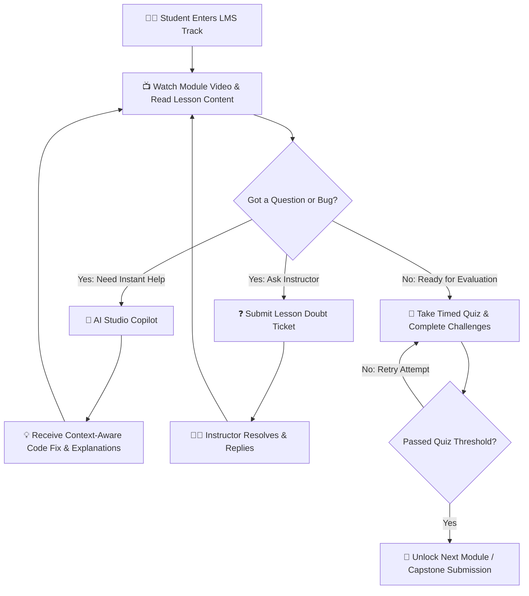
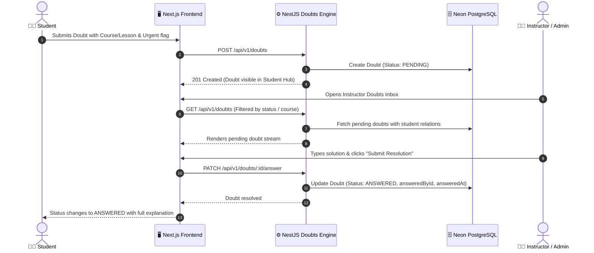
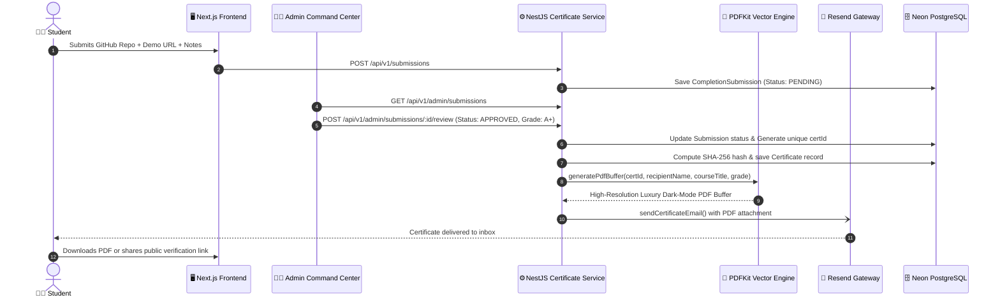

# DevAscent Academy — Next-Gen EdTech & Virtual Internship Platform

<div align="center">
  
  
  ### Empowering Next-Gen Engineers Through Production-Grade Practical Learning
  
  [](https://www.devascentacademy.me)
  [](https://devascent-academy.onrender.com)
  [](LICENSE)
  [](https://nextjs.org)
  [](https://nestjs.com)
  [](https://neon.tech)
</div>

---

## 📑 Table of Contents

- [🏛️ Company Overview](#️-company-overview)
- [🌐 Live Infrastructure & Core Links](#-live-infrastructure--core-links)
- [⚡ Technology Stack](#-technology-stack)
- [🎓 How It Works for Students (Step-by-Step)](#-how-it-works-for-students-step-by-step)
- [✨ Key Platform Features & Modules](#-key-platform-features--modules)
- [📊 System Architecture & Flowcharts](#-system-architecture--flowcharts)
  - [1. Authentication & OTP Verification Flow](#1-authentication--otp-verification-flow)
  - [2. Course Discovery & Razorpay Payment Flow](#2-course-discovery--razorpay-payment-flow)
  - [3. Interactive Learning & AI Copilot Flow](#3-interactive-learning--ai-copilot-flow)
  - [4. Student Doubt & Instructor Q&A Flow](#4-student-doubt--instructor-qa-flow)
  - [5. Capstone Submission & Certificate Issuance Flow](#5-capstone-submission--certificate-issuance-flow)
- [🛡️ Tamper-Proof Certificate & Verification System](#️-tamper-proof-certificate--verification-system)
- [💼 Admin Command Center](#-admin-command-center)
- [🔒 Enterprise Security & Data Integrity Standards](#-enterprise-security--data-integrity-standards)
- [📦 Deployment Architecture](#-deployment-architecture)
- [👥 Leadership & Contact](#-leadership--contact)

---

## 🏛️ Company Overview

**DevAscent Academy** is an accredited technology training and virtual internship platform built for aspiring developers, computer science students, and engineering professionals. We bridge the gap between theoretical academic curriculums and high-scale production engineering.

### 🌟 Core Value Propositions
- **Hands-on Virtual Internships**: Real-world capstone projects spanning full-stack development, algorithmic systems, AI engineering, and modern cloud architectures.
- **AI-Powered Code Mentor**: Built-in 24/7 AI learning copilot that provides instant code reviews, debugging assistance, and conceptual guidance.
- **Doubt Resolution Hub**: Direct interactive Q&A between students and instructors with status tracking and urgency filters.
- **Broadcast Notifications & Announcements**: Target-driven updates delivering real-time platform news, cohort notices, and direct student communications.
- **Tamper-Proof Digital Credentials**: High-resolution luxury dark-mode PDF certificates embedded with cryptographic SHA-256 signatures and instant public verification QR codes.
- **7-Day Transparent Guarantee**: Built-in automated refund tracking system ensuring student protection and peace of mind.

---

## 🌐 Live Infrastructure & Core Links

| Service | Destination / URL | Provider |
|---|---|---|
| **Production Domain** | [https://www.devascentacademy.me](https://www.devascentacademy.me) | Vercel Custom Domain + SSL |
| **Vercel Edge Mirror** | [https://dev-ascent-academy.vercel.app](https://dev-ascent-academy.vercel.app) | Vercel Edge CDN |
| **Backend REST API** | [https://devascent-academy.onrender.com/api/v1](https://devascent-academy.onrender.com/api/v1) | Render Cloud Services |
| **Serverless Database** | Neon PostgreSQL (Connection Pooling + SSL) | Neon AWS US-East-2 |
| **Email Gateway** | Resend HTTP API + Gmail SMTP Dual-Stack | Resend DNS Verified Domain |
| **Public Verification** | `https://www.devascentacademy.me/verify/:certId` | DevAscent Public Ledger |

---

## ⚡ Technology Stack

### Frontend Architecture
- **Framework**: [Next.js 14](https://nextjs.org/) (App Router, Server Components & Client Hydration)
- **Styling & Design System**: Tailwind CSS, CSS Custom Properties, Lucide Icons, Framer Motion-inspired animations
- **State & Data Fetching**: Zustand, SWR (stale-while-revalidate), React Hook Form, Zod validation
- **PDF & QR Visualization**: Native canvas, dynamic download handlers, Lucide React

### Backend Architecture
- **Framework**: [NestJS 10](https://nestjs.com/) (Modular Architecture, Dependency Injection)
- **ORM & Database**: Prisma ORM with [Neon Serverless Postgres](https://neon.tech/)
- **Security & Auth**: JWT (Access & Refresh Tokens in HttpOnly secure cookies), Bcrypt password hashing, Google OAuth 2.0
- **Email Dispatch**: Resend HTTP API (Port 443 HTTPS firewall-proof) with automated Gmail SMTP fallback
- **Certificate Engine**: PDFKit vector engine with dynamic QR code generation (`qrcode`) and cryptographic SHA-256 hashing

---

## 🎓 How It Works for Students (Step-by-Step)

```
   [ 1. Explore & Register ]
              │
              ▼
   [ 2. 6-Digit Email OTP Verification ]
              │
              ▼
   [ 3. Enroll / Instant Razorpay Checkout ]
              │
              ▼
   [ 4. Unlock Interactive Modules & Video Lessons ]
              │
              ▼
   [ 5. Ask Questions & AI Copilot Debugging ]
              │
              ▼
   [ 6. Complete Capstone Project & Submit Repository ]
              │
              ▼
   [ 7. Admin Review & Grade Assignment ]
              │
              ▼
   [ 8. Receive Tamper-Proof Certificate (PDF + Live QR) ]
```

1. **Sign Up & Email Verification**: Students register using their academic or personal email. A non-blocking 6-digit OTP is instantly dispatched to their inbox.
2. **Browse Curriculum & Enroll**: Students browse accredited cohorts (Python, Full-Stack Web Development, AI Engineering, etc.) and complete enrollment via Razorpay secure checkout.
3. **Structured Learning**: Access module lessons, video lectures, coding quizzes, and downloadable resources in the dedicated LMS classroom.
4. **AI Studio & Doubt Resolution**: When stuck on bugs or syntax errors, students can use the AI Studio Copilot or submit doubts directly to instructors.
5. **Capstone Submission**: After finishing curriculum modules, students submit their production repository (GitHub URL) and live demo deployment.
6. **Instructor Review & Certification**: Once approved by the lead instructor, a luxury dark-mode PDF certificate with embedded QR verification is automatically minted, emailed, and added to the student profile.

---

## ✨ Key Platform Features & Modules

### 1. ❓ Interactive Doubt Resolution & Instructor Help Desk
- Students can submit contextual doubt tickets attached directly to specific courses and lessons.
- Includes **Urgency Flagging** (`isUrgent`) for critical debugging blockers.
- Status lifecycles (`PENDING` ➔ `ANSWERED`) with real-time instructor reply dispatch and attribution.

### 2. 📢 Targeted Broadcast Announcements & Notification Engine
- Multi-tier alert broadcasting supporting `ALL`, role-specific (`STUDENT`, `ADMIN`), or cohort-specific announcements.
- Granular course alerts linked directly to cohort syllabuses.
- Individual student direct messaging hub with persistent read-receipt tracking (`NotificationRead`).

### 3. ⏱️ Timed Quiz Engine & Multi-Attempt Evaluations
- Interactive module and lesson-level quizzes with strict passing thresholds (e.g. 70%).
- Integrated countdown timers (`timeLimitMin`) with automated auto-submit safeguards.
- Multi-attempt management (`QuizAttempt`) with detailed historical logs, code snippet evaluation, and explanations.

### 4. 🎟️ Flexible Coupon & Promotion Engine
- Support for percentage (`PERCENT`) and flat-rate (`FLAT`) discounts.
- Enforced expiration windows (`expiresAt`), total usage limits (`maxUses`), and auto-apply configurations.
- Direct integration with Razorpay dynamic checkout orders.

### 5. 🎨 Design System & Usability Architecture (WCAG AA)
- Unified typography hierarchy conforming strictly to standard design tokens (no fragmented font sizes).
- Semantic heading structure (`H1` ➔ `H2` ➔ `H3`) ensuring screen reader compliance and SEO crawlability.
- Co-located interactive certificate generator providing real-time live preview of student credentials.
- Contrast-checked luxury dark/light mode palette with accessible interactive button affordances.

---

## 📊 System Architecture & Flowcharts

### 1. Authentication & OTP Verification Flow



---

### 2. Course Discovery & Razorpay Payment Flow



---

### 3. Interactive Learning & AI Copilot Flow



---

### 4. Student Doubt & Instructor Q&A Flow



---

### 5. Capstone Submission & Certificate Issuance Flow



---

## 🛡️ Tamper-Proof Certificate & Verification System

Every credential generated by DevAscent Academy features multi-layered verification:

```
╔═══════════════════════════════════════════════════════════════════════╗
║                                                                       ║
║   1. Tamper-Proof Cryptographic ID: DEV-BATCH12-8B9E73               ║
║   2. SHA-256 Hash Digest: Stored in immutable database record         ║
║   3. Embedded Scannable QR Code: Points directly to public ledger     ║
║   4. Live Public URL: https://www.devascentacademy.me/verify/         ║
║   5. Gold Foil Medallion Official Seal + Verified Founder Signature   ║
║                                                                       ║
╚═══════════════════════════════════════════════════════════════════════╝
```

### Public Verification Endpoint
- Anyone (recruiters, universities, employers) can scan the QR code or visit:
  `https://www.devascentacademy.me/verify/:certId`
- The system checks the database in real-time and renders a verified badge with student name, track title, issue date, grade, and credential status.

---

## 💼 Admin Command Center

DevAscent Academy includes an enterprise admin portal located at `/admin`:

- **📊 Dashboard & Metrics**: Real-time revenue analytics, active students, enrollment velocity, and completion rates.
- **📖 Course & Curriculum Builder**: Create and edit courses, video modules, lessons, quizzes, and cohort limits.
- **❓ Doubts & Help Desk**: Review pending student blockers, filter by urgency, and publish authoritative answers.
- **📢 Announcements & Notifications**: Dispatch platform broadcasts, cohort notices, and direct student alerts.
- **🎟️ Coupons & Discount Engine**: Manage promo codes (`PERCENT` / `FLAT`), expiration gates, and redemption limits.
- **👥 Student Directory**: View registered users, verification statuses, and enrolled tracks.
- **📋 Enrollments Manager**: Track student progress percentages, activation statuses, and enrolled dates.
- **✅ Capstone Review Queue**: Review student project submissions, assign grades (`Distinction (A+)`, `A`, `B`), and approve certificates.
- **💳 Payments & Refunds**: Monitor Razorpay transactions and process student 7-day refund requests.
- **📜 System Audit Logs**: Comprehensive audit trail of all administrative actions.

---

## 🔒 Enterprise Security & Data Integrity Standards

DevAscent Academy enforces enterprise-grade security, cryptographic verification, and zero-trust engineering across both student and administrative interfaces:

### 1. 🛡️ Zero-Trust Session & Token Architecture
- **HttpOnly & Secure Cookie Enclave**: JWT access and refresh tokens are stored exclusively inside `HttpOnly`, `SameSite=Strict`, `Secure` cookies, eliminating vulnerabilities to cross-site scripting (XSS) token theft.
- **Bcrypt Password Cryptography**: Passwords undergo high-iteration cryptographic salting and hashing via Bcrypt before any persistence.
- **Session Expiry & Rotation**: Short-lived access tokens paired with secure refresh token rotation prevent replay attacks.

### 2. 🔏 Cryptographic Proof of Credential Authenticity
- **Deterministic SHA-256 Digest**: Each issued graduation certificate is stamped with an immutable SHA-256 hash derived from the recipient's identity, course ID, issue timestamp, and official graduation grade.
- **Real-Time Ledger Lookup**: Scanning the embedded QR code performs an instant query against our verified backend ledger (`/api/v1/certificates/verify/:certId`), preventing fraudulent diploma mill replication.
- **Official Gold Foil Seal**: High-resolution vector rendering produces printable credentials protected against unauthorized manual alteration.

### 3. 💳 Hardened Payment & Order Security
- **HMAC-SHA256 Webhook Verification**: Razorpay payment confirmations require rigorous server-side cryptographic HMAC-SHA256 signature verification prior to course provisioning or enrollment activation.
- **Idempotent Order Fulfillments**: Orders are protected with unique payment hashes to prevent race conditions or duplicate access grants.
- **Automated Refund Guard**: Built-in 7-day refund tracking with status gates (`SUBMITTED`, `PROCESSED`, `REJECTED`) guarantees financial transparency.

### 4. 👥 Role-Based Access Control (RBAC) & Audit Logging
- **Strict Role Separation**: NestJS guards enforce strict segregation between `STUDENT` and `ADMIN` privileges. Administrative endpoints are completely sealed off from student session tokens.
- **Immutable Audit Trail**: All privileged administrative operations (course updates, manual status overrides, grade awards, refunds) are permanently recorded in the `AuditLog` table with IP addresses and user agents.

### 5. 📧 Anti-Abuse & Rate-Limited Communication
- **Rate-Limited OTP Gates**: Email verification codes are protected by strict attempt thresholds (`maxAttempts: 3`) and short 15-minute expiration windows.
- **Firewall-Proof HTTPS Email API**: Direct API dispatch via Resend on HTTPS Port 443 ensures 99.9% inbox deliverability without exposure to blocked SMTP ports.

---

## 📦 Deployment Architecture

```
                 ┌────────────────────────────────┐
                 │       🌐 Vercel Edge CDN       │
                 │   (Next.js 14 Frontend App)    │
                 │ dev-ascent-academy.vercel.app  │
                 └───────────────┬────────────────┘
                                 │ HTTPS REST API
                                 ▼
                 ┌────────────────────────────────┐
                 │      ⚙️ Render Web Service      │
                 │    (NestJS REST API Engine)    │
                 │ devascent-academy.onrender.com │
                 └───────────────┬────────────────┘
                                 │
         ┌───────────────────────┼───────────────────────┐
         ▼                       ▼                       ▼
┌──────────────────┐    ┌──────────────────┐    ┌──────────────────┐
│ 🗄️ Neon Postgres  │    │ 📧 Resend Engine  │    │ 💳 Razorpay API  │
│ (Pooled Cloud DB)│    │ (HTTPS Port 443) │    │(Payments/Refunds)│
└──────────────────┘    └──────────────────┘    └──────────────────┘
```

---

## 👥 Leadership & Contact

- **Founder & Lead Instructor**: Shivan Mishra
- **Official Website**: [https://dev-ascent-academy.vercel.app](https://dev-ascent-academy.vercel.app)
- **Domain**: `devascentacademy.me`
- **Support & Inquiries**: `shivrom.2020@gmail.com`

<div align="center">
  <sub>© 2026 DevAscent Academy. All rights reserved. Empowering Next-Gen Engineers.</sub>
</div>
